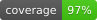

# Coverage

Auto-generated by `pnpm coverage`. Do not edit by hand. Coverage is produced locally
by `c8` (V8 coverage) and aggregated across all published packages: no third-party
coverage service is involved.

**Repo-wide line coverage: 96.52%**

| Package | Lines | Statements | Functions | Branches |
|---|---|---|---|---|
| `@did-btcr2/aggregation` | 96.0% (11093/11559) | 96.0% (11093/11559) | 88.8% (389/438) | 86.1% (1632/1896) |
| `@did-btcr2/api` | 98.7% (4618/4679) | 98.7% (4618/4679) | 99.5% (197/198) | 97.2% (794/817) |
| `@did-btcr2/bitcoin` | 89.3% (1337/1497) | 89.3% (1337/1497) | 96.0% (95/99) | 96.6% (225/233) |
| `@did-btcr2/cli` | 95.1% (7025/7388) | 95.1% (7025/7388) | 95.7% (265/277) | 90.5% (1467/1621) |
| `@did-btcr2/integrity` | 98.4% (1669/1696) | 98.4% (1669/1696) | 94.5% (52/55) | 96.4% (265/275) |
| `@did-btcr2/key-manager` | 99.3% (668/673) | 99.3% (668/673) | 100.0% (29/29) | 94.0% (63/67) |
| `@did-btcr2/keys` | 90.5% (1135/1254) | 90.5% (1135/1254) | 80.6% (54/67) | 88.6% (109/123) |
| `@did-btcr2/method` | 97.9% (7937/8105) | 97.9% (7937/8105) | 93.7% (178/190) | 96.0% (1246/1298) |
| `@did-btcr2/smt` | 99.4% (1230/1237) | 99.4% (1230/1237) | 98.7% (78/79) | 96.1% (271/282) |
| `@did-btcr2/std` | 99.6% (1659/1666) | 99.6% (1659/1666) | 98.8% (85/86) | 94.6% (388/410) |
| **Total** | **96.5% (38371/39754)** | **96.5% (38371/39754)** | **93.7% (1422/1518)** | **92.0% (6460/7022)** |
